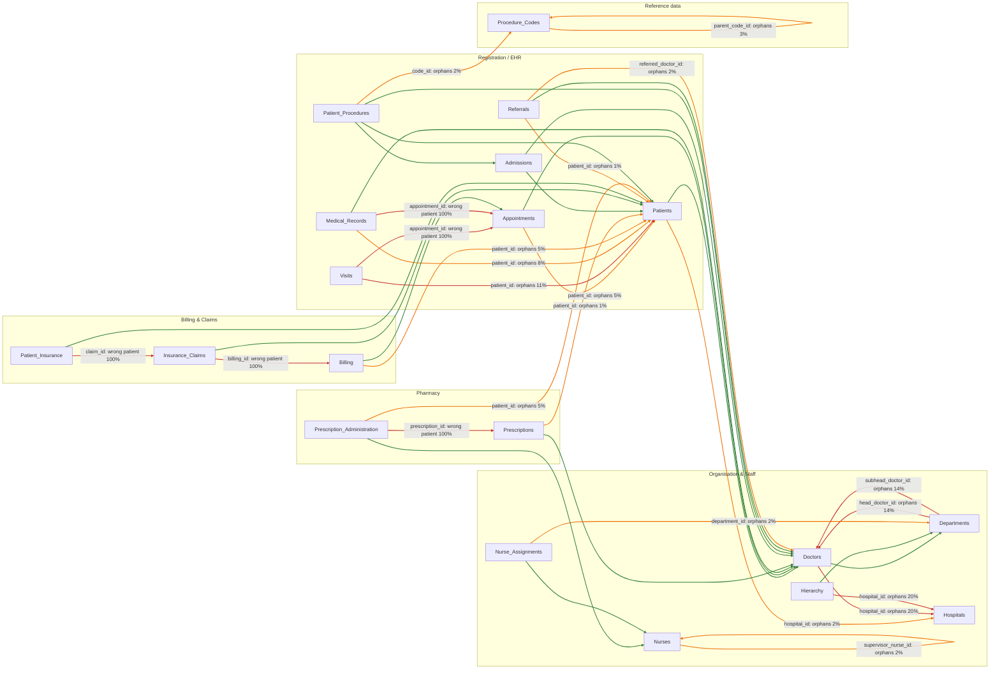

# Root-Cause Report

*Generated by `python -m hcls rootcause` (run 2026-10-21T20:23:18Z, commit 26d0c9f4). As-of date 2026-10-21. Numbers come from the SQL in `sql/rootcause/`; verdicts are computed in `src/hcls/rootcause/evidence.py`. Do not edit by hand.*

## 1. The answer in plain language

| Issue | What is going on | Is it a break? | Who needs to act |
|---|---|---|---|
| **90 claims with no approved amount** | **Expected, not corrupt.** All 90 are claims the insurer has not decided yet (Submitted, Pending, In Review). Every decided claim has an amount. | No. Same rate in every year (2020-2026). | Finance: report these as *pipeline (estimated)*, not as missing. |
| **123 visits with no appointment** | **A capture gap in the source system** (nothing forces a visit to be linked). It is also worse than it looks: of the 277 visits that *do* name an appointment, only 1 name the same patient. | No. Same rate in every year (2020-2026). | Source-system owner and ETL owner. |
| **40 records with prescribed_meds = None** | **A capture or default-value problem.** 20 of the 40 have a treatment plan that names a drug, so `None` is wrong for those. The other 20 need a clinician. | Cannot tell: 94% of medical records are from 2024 onward. | Clinical owner, then ETL owner. |
| **Claims do not link to the right bill** (and four other links) | **An ETL key-mapping failure plus no foreign-key enforcement.** Claims point at a bill for the same patient 0 times in 250. This is not a shifted row and cannot be repaired by joining on patient. | Present since the first record. | ETL owner. **Blocks the over-charging answer.** |

**Bottom line for the auditors:** the problems are *systemic and long-standing*, not an incident. They share two causes: **no validation at the point of entry** and **keys that are not conformed between tables**. Neither started last week.

## 2. Answers to Key Questions 1-4

| # | Question | Answer |
|---|---|---|
| 1 | Where did the data break? | C01: nowhere, it is by design. C02 and C03: at the **source application / database** (no constraint or default-value text). Cross-table links: in the **ETL key mapping**, with a **source database that does not enforce foreign keys**. See section 5. |
| 2 | When did it start? | **Always.** C01 and C02 are present in all 7 years with no change in rate (p = 0.9589 and 0.502). C03 cannot be dated: 206 records exist but almost all are from 2024-2026. |
| 3 | How many more issues? | Many more rules report findings; the full ranked list is in `docs/01_dq_scorecard.md`. The most serious are the five Critical rules, which this report explains. |
| 4 | Is it systemic? | **Yes.** Five of the six tested links match the same patient in under 5% of rows, and placeholder ids appear in 8 tables. One cause (no validation at entry) explains most of it; the key-mapping failure is a second, independent cause. |

## 3. When did it start? (timeline test)

Chi-square test that every year has the same failure rate. A p-value of 0.05 or more means no evidence of a change.

| rule_id | table | records | failed | overall_rate_pct | years_with_failures | first_year | last_year | years_tested | p_value | verdict |
|---|---|---|---|---|---|---|---|---|---|---|
| C01 | Insurance_Claims | 250 | 90 | 36 | 7 | 2020 | 2026 | 7 | 0.9589 | flat (no evidence of a break) |
| C02 | Visits | 400 | 123 | 30.8 | 7 | 2020 | 2026 | 7 | 0.502 | flat (no evidence of a break) |
| C03 | Medical_Records | 206 | 40 | 19.4 | 4 | 2023 | 2026 | 3 | 0.18 | flat (no evidence of a break) |
| A02 | Insurance_Claims | 250 | 250 | 100 | 7 | 2020 | 2026 | 7 | 1 | constant: every record fails |
| A30 | Prescription_Administration | 400 | 400 | 100 | 5 | 2018 | 2026 | 3 | 1 | constant: every record fails |


Failure rate by year (%):

| year | C01 | C02 | C03 |
|---|---|---|---|
| 2020 | 34.3 | 37.1 |  |
| 2021 | 33.3 | 24.5 | 0 |
| 2022 | 42.4 | 30.1 | 0 |
| 2023 | 35.7 | 28.8 | 33.3 |
| 2024 | 33.3 | 34.8 | 16.2 |
| 2025 | 41 | 21.3 | 26.4 |
| 2026 | 32.4 | 35.9 | 15 |


C03: before 2024 the table holds only 6 records, so those years are not tested. Quarterly rates are in `outputs/gold/rootcause/timeline_long.csv`.

## 4. Do the links between tables work?

For every link that exists, we compared the patient on the child row with the patient on the parent row. They should be the same person.

| link | linked_rows | same_patient | same_patient_pct | median_gap_days |
|---|---|---|---|---|
| Visits -> Appointments | 277 | 1 | 0.4 | 834 |
| Medical_Records -> Appointments | 177 | 0 | 0 | 336 |
| Billing -> Appointments | 249 | 248 | 99.6 | 314 |
| Insurance_Claims -> Billing | 250 | 0 | 0 | 721.5 |
| Patient_Insurance -> Insurance_Claims | 230 | 0 | 0 |  |
| Prescription_Administration -> Prescriptions | 400 | 0 | 0 | 408.5 |


- **Billing -> Appointments is the control:** 99.6% match, so consistent keys *are* achievable in this system.
- The others are effectively **random**: a match rate near zero is what two unrelated lists of ids would give.
- **Claims vs bills:** a claim's submitted amount is a median **64x** the bill it points at; only 1 of 250 are within 25%. Shifting the join by up to 10 rows matches at most 1 pair. Only 9 of 250 claim patients have *any* bill.

Example pairs (first ten claims):

| claim_id | billing_id | claim_patient_id | bill_patient_id | submitted_amount | bill_total | submitted_date | billing_date |
|---|---|---|---|---|---|---|---|
| 1 | 10 | 3005 | 3458 | 33141.15 | 334 | 2023-03-27 | 2024-08-25 |
| 2 | 131 | 952 | 2264 | 8830.4 | 206 | 2026-01-01 | 2024-04-24 |
| 3 | 183 | 3033 | 2972 | 18813.28 | 192 | 2026-10-31 | 2024-09-27 |
| 4 | 135 | 2080 | 1743 | -39572.72 | 224 | 2026-05-22 | 2026-10-05 |
| 5 | 234 | 1988 | 3442 | 3914 | 213 | 2022-07-13 | 2026-05-09 |
| 6 | 126 | 2909 | 4501 | 12448.47 | 492 | 2021-05-30 | 2024-10-23 |
| 7 | 207 | 4683 | 2062 | 480.75 | 517 | 2021-07-24 | 2025-11-09 |
| 8 | 62 | 1923 | 3113 | 30398.27 | 246 | 2025-06-17 | 2024-03-22 |
| 9 | 177 | 4959 | 171 | 8938.54 | 458 | 2026-06-05 | 2025-09-19 |
| 10 | 166 | 1432 | 2291 | 36470.04 | 1457 | 2020-02-23 | 2026-10-20 |


### Lineage map (hypothesised systems, measured link health)

Green = healthy (<1% bad), orange = degraded (1-10%), red = broken (>=10%). Boxes are grouped by the source system we *infer* from how the tables relate; the ETL owner must confirm the grouping.



| child_table | child_column | parent_table | orphan_pct | wrong_patient_pct | status | crosses_systems |
|---|---|---|---|---|---|---|
| Hierarchy | hospital_id | Hospitals | 20.06 |  | broken | False |
| Doctors | hospital_id | Hospitals | 19.74 |  | broken | False |
| Departments | head_doctor_id | Doctors | 14.29 |  | broken | False |
| Departments | subhead_doctor_id | Doctors | 14.29 |  | broken | False |
| Visits | patient_id | Patients | 11.25 |  | broken | False |
| Medical_Records | patient_id | Patients | 7.77 |  | degraded | False |
| Billing | patient_id | Patients | 5.2 |  | degraded | True |
| Prescription_Administration | patient_id | Patients | 5 |  | degraded | True |
| Appointments | patient_id | Patients | 4.8 |  | degraded | False |
| Procedure_Codes | parent_code_id | Procedure_Codes | 2.56 |  | degraded | False |
| Patient_Procedures | code_id | Procedure_Codes | 2 |  | degraded | True |
| Referrals | referred_doctor_id | Doctors | 2 |  | degraded | True |
| Nurse_Assignments | department_id | Departments | 2 |  | degraded | False |
| Nurses | supervisor_nurse_id | Nurses | 1.87 |  | degraded | False |
| Patients | hospital_id | Hospitals | 1.64 |  | degraded | True |
| Prescriptions | patient_id | Patients | 1 |  | degraded | True |
| Referrals | patient_id | Patients | 1 |  | degraded | False |
| Medical_Records | appointment_id | Appointments | 0.56 | 100 | broken | False |
| Patient_Insurance | claim_id | Insurance_Claims | 0 | 100 | broken | False |
| Insurance_Claims | billing_id | Billing | 0 | 100 | broken | False |
| Visits | appointment_id | Appointments | 0 | 99.6 | broken | False |
| Prescription_Administration | prescription_id | Prescriptions | 0 | 100 | broken | False |


## 5. Hypothesis tree and verdicts

Each hypothesis names the layer where the fault would sit, the test we ran, and what the data said. Verdicts are computed, not opinion.

### C01 - Claims with no approved amount (90 of 250)

| ID | Layer | Hypothesis | Test | Result | Verdict |
|---|---|---|---|---|---|
| H1.1 | ETL | The pipeline dropped approved_amount for some claims that had one. | Count blanks among claims the insurer has already decided (Approved, Denied, Appealed). | 0 of 160 decided claims are blank. | **RULED OUT** |
| H1.2 | Process / design | approved_amount is only filled in once the insurer decides, so blanks are expected on open claims. | Compare blanks with claim status; check approved_date is blank on exactly the same claims. | 90 of 90 claims in Submitted / Pending / In Review are blank; 0 of 160 decided claims are blank; approved_date is blank on exactly the same claims. | **CONFIRMED** |
| H1.3 | Source application | A recent change stopped the field being filled. | Chi-square test of the yearly blank rate. | Blank in 7 of 7 years (2020-2026); p = 0.9589; flat (no evidence of a break). | **RULED OUT** |

### C02 - Visits with no appointment (123 of 400)

| ID | Layer | Hypothesis | Test | Result | Verdict |
|---|---|---|---|---|---|
| H2.1 | Source application / database | Visits can be saved without an appointment (walk-ins, emergencies) and no rule forces a link. | Rate by year and by visit note; orphan ids elsewhere show whether the source enforces any constraint. | 123 visits have no appointment; blank in 7 of 7 years (flat (no evidence of a break), p = 0.502); the rate does not depend on the visit note; placeholder ids exist in 8 tables (see sentinel analysis). | **LIKELY** |
| H2.2 | ETL | The link existed in the source and was lost during loading. | If it was lost, the same patient should have an appointment on file. | Only 7 of the 123 unlinked visits belong to a patient who has any appointment at all. | **NOT SUPPORTED** |
| H2.3 | ETL / key mapping | The links that ARE present are correct. | For visits that do have an appointment, compare the visit's patient with the appointment's patient. | Only 1 of 277 linked visits (0.4%) point at an appointment for the same patient; median gap between visit and appointment date is 834 days. | **RULED OUT** |

### C03 - Medical records with no prescribed medicine (40 of 206)

| ID | Layer | Hypothesis | Test | Result | Verdict |
|---|---|---|---|---|---|
| H3.1 | Clinical meaning | 'None' correctly means no medicine was prescribed. | A treatment plan that names a drug should have a prescribed medicine. | 20 of 110 records whose plan names a drug (18.2%) have prescribed_meds = None, versus 20.8% where the plan is not a drug. Those 20 are contradictions; the other 20 cannot be judged without a clinician. | **PARTLY RULED OUT** |
| H3.2 | Source application | The application writes the word 'None' when the medication field is left empty. | All 40 are the literal text 'None' (zero real blanks); the rate is the same whether or not the plan names a drug. | 40 records, all literal 'None'; 18.2% vs 20.8% by plan type; failing years 2023-2026. | **LIKELY** |
| H3.3 | Recovery | The missing medicines can be backfilled from the Prescriptions table. | Find prescriptions for the same patient on or before the record date. | 3 of 40 patients have any prescription; 0 match the same doctor. | **NOT FEASIBLE** |
| H3.4 | Source application | A recent change introduced the problem. | Yearly rate; only years with at least 10 records can be tested. | Only 3 years have enough records (earlier years hold 6 records in total); p = 0.18, flat (no evidence of a break). | **INCONCLUSIVE** |

### Broken links between tables (A02, A30 and four more)

| ID | Layer | Hypothesis | Test | Result | Verdict |
|---|---|---|---|---|---|
| H4.1 | ETL | Bills were attached to claims a fixed number of rows out of place (positional shift). | Shift billing_id by -10 .. +10 and count patient matches. | Best shift matches 1 of 244 pairs; at shift 0 it is 0. | **RULED OUT** |
| H4.2 | ETL | Claims should be joined to bills through the patient instead. | How many claims have a patient who appears in Billing at all? | 9 of 250 claims. Even on a patient join the amounts would not agree (median claim is 64x the bill; 1 of 250 within 25%). | **RULED OUT** |
| H4.3 | ETL / key mapping | Each table's patient and parent ids are generated or mapped independently, so most links do not line up. | For all six links that carry a patient on both sides, compare child and parent patients. | 5 of 6 links match the same patient in under 5% of rows (Visits -> Appointments, Medical_Records -> Appointments, Insurance_Claims -> Billing, Patient_Insurance -> Insurance_Claims, Prescription_Administration -> Prescriptions). Only Billing -> Appointments holds up, which proves consistent keys are possible. | **CONFIRMED** |
| H4.4 | Source database | The source does not enforce foreign keys, so placeholder ids (0, -1, 88888, 9999x) get stored. | Count orphan patient ids by table and trace one table's placeholders back to its parent. | 116 rows in 8 tables hold an id that matches no patient. 12 of 13 orphan bills inherit the same placeholder from their appointment, so it starts upstream. | **CONFIRMED** |

## 6. Placeholder (sentinel) patient ids

Ids that match no patient, grouped by what kind of placeholder they look like:

| table_name | placeholder_kind | rows_affected | distinct_values |
|---|---|---|---|
| Admissions | 88888 | 3 | 1 |
| Appointments | zero or negative | 6 | 4 |
| Appointments | 9999x | 6 | 4 |
| Billing | 9999x | 7 | 5 |
| Billing | zero or negative | 6 | 4 |
| Medical_Records | zero or negative | 9 | 4 |
| Medical_Records | 9999x | 6 | 3 |
| Medical_Records | 88888 | 1 | 1 |
| Prescription_Administration | 9999x | 20 | 5 |
| Prescriptions | zero or negative | 5 | 1 |
| Referrals | not a number | 2 | 2 |
| Visits | 9999x | 29 | 3 |
| Visits | zero or negative | 16 | 2 |


Of 13 bills with an orphan patient, **12** carry the same placeholder as their appointment. Because the Billing -> Appointments link is sound, this shows the placeholder is created in the appointment system and copied downstream.

## 7. C03 detail: is `None` a real answer?

| plan_type | records | meds_none | pct_none |
|---|---|---|---|
| plan is not a drug (diet, therapy, referral, test, vaccine) | 96 | 20 | 20.8 |
| plan names a drug | 110 | 20 | 18.2 |


| icd10_chapter | records | meds_none | pct_none |
|---|---|---|---|
| Mental | 22 | 8 | 36.4 |
| Endocrine | 47 | 11 | 23.4 |
| Nervous | 11 | 2 | 18.2 |
| Circulatory | 28 | 5 | 17.9 |
| Musculoskeletal | 23 | 4 | 17.4 |
| Genitourinary | 12 | 2 | 16.7 |
| Digestive | 7 | 1 | 14.3 |
| Respiratory | 32 | 4 | 12.5 |
| Factors | 24 | 3 | 12.5 |


Backfill from Prescriptions: 3 of 40 patients have any prescription and 0 match the same doctor, so **automatic backfill is not possible**; the remaining 37 need the clinician.

## 8. What this means for each stakeholder

| Stakeholder | What to tell them |
|---|---|
| **Finance** | The 90 blanks are open claims, not a data fault. Use the pipeline estimate. Do **not** compare claims to bills: the link is broken, so any gap you compute is meaningless. |
| **Compliance / Legal** | We **cannot confirm or rule out over-charging** from this data, and we can show why. Over-charging needs a trustworthy claim-to-bill link; fixing it is the first remediation item. The problems are long-standing, so expect auditors to ask about prior years. |
| **Patient Care** | 20 records name a drug in the plan but say `None`: review those first. The other 20 need a clinical decision on what `None` means. 3 of the 40 may be fillable from prescriptions. |
| **Engineering** | Validate at entry (NOT NULL / foreign keys), conform keys across systems, and add a daily check. Details in the Sprint 4 remediation plan. |

## 9. Limits of this analysis

- We have the data, not the systems. Layer names (application, ETL, database) are **inferred**; the interviews below turn inference into fact.
- 'Likely' and 'Not supported' are statements about this data, not proof of how the software works.
- C03 has too few pre-2024 records to date.

## Appendix A. Questions for the interviews

### Claims team
1. When does a claim get its `approved_amount`: at insurer decision, or at payment? Is a blank on an open claim intended?
2. How does a claim know which bill it belongs to? Where is `billing_id` set, and by whom?
3. Why would one bill id appear on several claims (89 repeats)? Are split or resubmitted claims expected?
4. Has anyone ever reconciled claim totals to bill totals? What did they use as the join?
5. Are negative submitted amounts ever valid (credits, reversals)?

### ETL / data-engineering owner
1. Which system is the source for each table group in the lineage map? Are the groupings right?
2. How are surrogate keys generated: per table, or conformed across systems? Is there a key-mapping table?
3. Is there a step that rewrites patient ids (masking, re-keying, test-data load)?
4. Do the source databases enforce foreign keys and NOT NULL? Since when?
5. Where do `0`, `-1`, `88888` and `9999x` patient ids come from (test data, default values, merge tool)?
6. Was there a migration, merge or reload around the first records (2018-2020)?

### Clinical owner
1. In `prescribed_meds`, does `None` mean 'no medicine prescribed' or 'not recorded'?
2. For the records whose plan names a drug but meds say `None`, which field is right?
3. Can visits legitimately exist without an appointment (walk-in, emergency)? How should they be recorded?

## Appendix B. ETL log checklist

- [ ] Job history for the claims, billing, visits and medical-record loads: first run date and any schema change
- [ ] Reject / error tables: are rows with missing or invalid keys silently accepted?
- [ ] Key-mapping or lookup tables used for patient, appointment, billing and prescription ids
- [ ] Row-count reconciliation between source and target on the last 10 loads
- [ ] Any 'default value' rules in the load (for example writing `None`, `0` or `-1`)
- [ ] Source-database constraints: list of foreign keys and NOT NULL columns per table, with creation dates
- [ ] Change log of the registration / appointment application releases (to test H1.3, H2.1, H3.2)
- [ ] Time-zone or date-format conversions applied to date columns (text dates, `2025-13-01`, `tomorrow`)

## Reproduce

```bash
python -m hcls rootcause     # needs: python -m hcls dq
```
